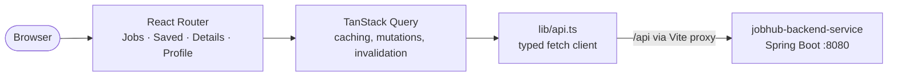

# JobHub – UI

**JobHub** gathers Java job postings for the German market from several free, public job APIs into one place and ranks them by how well they match your profile. This repository is the **React + TypeScript frontend**. The Spring Boot API lives in **[jobhub-backend-service](https://github.com/alamsoftware68/jobhub-backend-service)**.


---

## Features

- **One job list from many sources**: Bundesagentur für Arbeit, Arbeitnow, Adzuna and Jooble, each shown with its own source badge
- **Match score** (0–100) on every job, with a *best match* or *newest first* sort
- **Rich filtering**: free-text search, city, country, source, minimum match, posting date, remote only, and *English-speaking jobs only*
- **Dashboard stats**: jobs found, new in the last 24 h, saved jobs, active sources
- **Save or hide** jobs, plus a dedicated *Saved* view
- **Job details**: full description, the profile skills that matched, an *Apply* button, and links to the same job on other sites
- **Profile editor**: skills, search keywords, locations, radius, work mode, language preference and excluded words, edited with a tag input. Saving re-scores every job.
- **Light and dark mode** using Tailwind's `dark:` variants
- **Live fetching**: trigger a fetch for a new city or country, and see the status of each source

---

## Pages

| Route | Page | What it does |
|-------|------|--------------|
| `/` | Jobs | All jobs with match score, filters, sorting and stats |
| `/saved` | Saved | Jobs you starred |
| `/jobs/:id` | Job details | Description, matched skills, Apply button, duplicate links |
| `/profile` | Profile | Preferences that drive search and scoring |

---

## Architecture



- **Server state** is handled entirely by **TanStack Query**: queries for jobs, stats, sources and profile, plus mutations for save/hide, refresh and profile updates, with cache invalidation
- **Typed API layer**: `src/lib/api.ts` defines TypeScript types that mirror the backend DTOs
- **No CORS problems in development**: Vite proxies `/api` to `http://localhost:8080`

### Project structure

```
src
├── main.tsx              # React root, QueryClient, Router
├── App.tsx               # routes
├── pages/
│   ├── JobsPage.tsx      # list, filters, stats, saved view
│   ├── JobDetailPage.tsx # job details
│   └── ProfilePage.tsx   # profile editor
├── components/
│   ├── Layout.tsx        # shell, navigation, fetch trigger, source status
│   ├── JobCard.tsx       # job row with score and source badge
│   └── TagInput.tsx      # reusable tag/chip input
└── lib/
    ├── api.ts            # typed REST client
    └── format.ts         # dates, source colours, labels
```

---

## Tech stack

| Concern | Choice |
|---------|--------|
| UI | React 19 |
| Language | TypeScript |
| Build / dev server | Vite 8 |
| Styling | Tailwind CSS 4 |
| Data fetching | TanStack Query 5 |
| Routing | React Router 7 |
| Linting | oxlint |
| CI | GitHub Actions (lint + type-check + build) |

---

## Getting started

### Prerequisites
- Node.js 22 (or 20.19+)
- The **[jobhub-backend-service](https://github.com/alamsoftware68/jobhub-backend-service)** running on port 8080

### Run

```bash
npm install
npm run dev          # http://localhost:5173
```

Calls to `/api` are proxied to the backend at `http://localhost:8080` (see `vite.config.ts`).

### Other scripts

```bash
npm run build        # type-check + production build into dist/
npm run preview      # serve the production build
npm run lint         # oxlint
```

---

## Roadmap

- Application tracker board (Saved → Applied → Interview → Offer)
- Component tests with Vitest + React Testing Library
- Login when the backend adds authentication

---

## Author

**Alam** – Java full-stack developer (Java / Spring Boot, React) with 10+ years of experience
GitHub: [@alamsoftware68](https://github.com/alamsoftware68)
